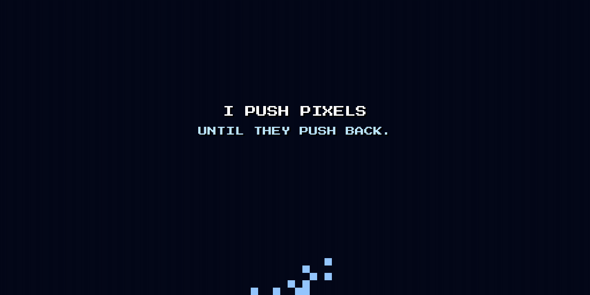
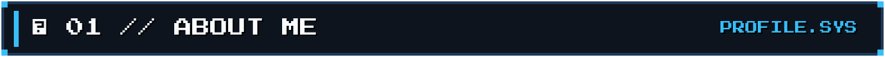
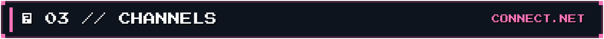
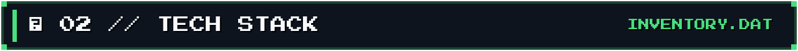
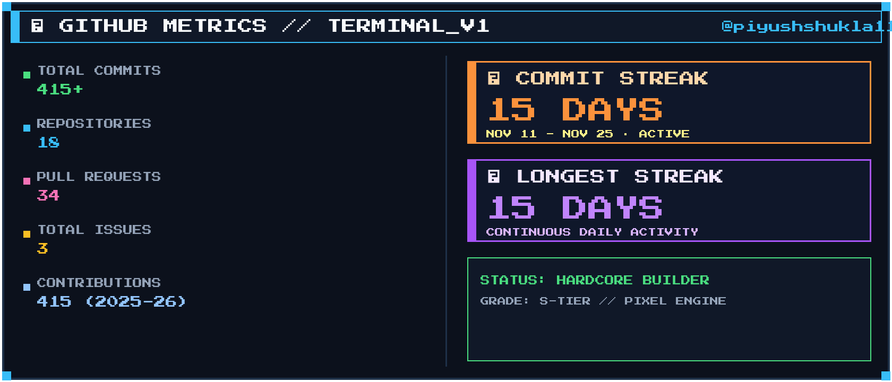
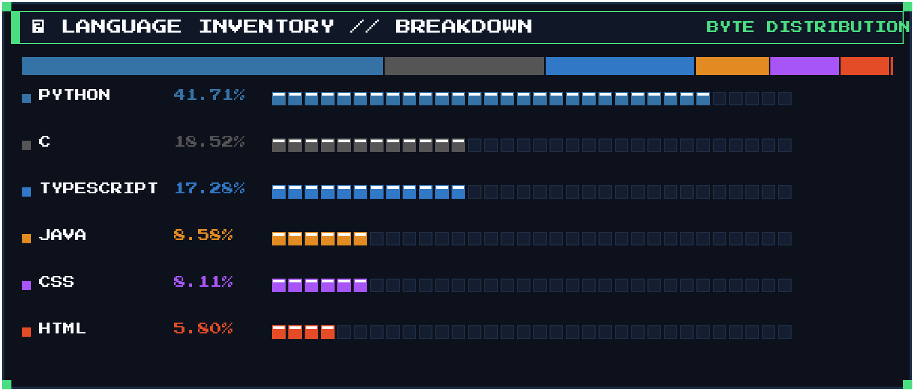

  <a href="https://github.com/piyushshukla11/piyushshukla11/blob/main/assets/minecraft_pixels_push_back.mp4" title="Click to view full video">
    <picture>
      <source type="image/webp" srcset="https://raw.githubusercontent.com/piyushshukla11/piyushshukla11/main/assets/banner.webp">
      
    </picture>
  </a>

 

> **`SYS.INIT`** ── *"Keep on building is my core philosophy."*
> 
> Software developer focused on **Game Development**, **Cybersecurity**, and **Web Development**, always understanding and building systems from the ground up.

 

  
  
  
  

 

  
  
  
  
  
  
  
  
  
  
  

 

  

 

  

  

---

  

